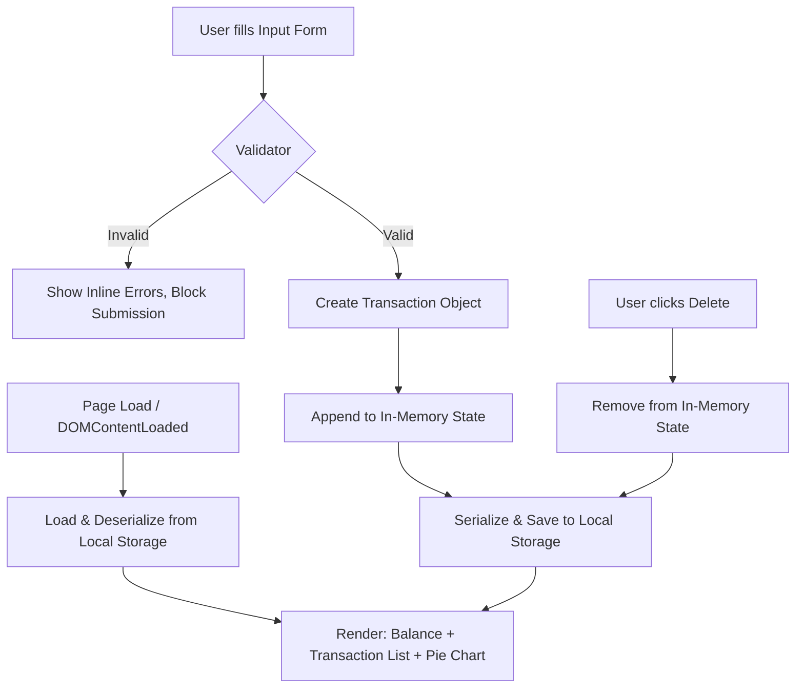
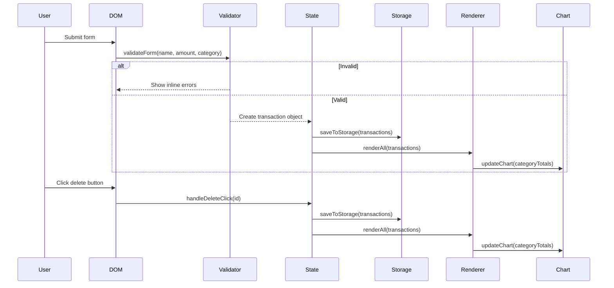

# Design Document

## Overview

The Expense & Budget Visualizer is a single-page, client-side web application built with pure HTML, CSS, and Vanilla JavaScript. It enables users to record personal expense transactions, view a running total balance, browse a scrollable transaction history, and understand their spending distribution through a live pie chart — all without a backend server or build toolchain.

All application state is persisted in the browser's Local Storage, making the app fully self-contained and usable offline. Chart.js (loaded via CDN) provides the pie chart rendering. The entire application lives in three files: `index.html`, `css/style.css`, and `js/app.js`.

### Goals

- Simple, zero-dependency expense tracking that works offline and requires no installation
- Immediate visual feedback on spending patterns through a live-updating pie chart
- Data survives browser refreshes and tab closures via Local Storage persistence
- Accessible and responsive across viewport widths from 320 px to 1920 px and across all modern browsers

---

## Architecture

The application follows a **single-page, event-driven MVC-lite architecture** entirely within `js/app.js`. There is no module bundler, no framework, and no server — every concern is handled in the browser.

### High-Level Flow



### Layered Responsibilities

| Layer | Where | Responsibility |
|---|---|---|
| **Presentation** | `index.html` + `css/style.css` | Static HTML structure, CSS layout & theming |
| **State** | `js/app.js` — `state` object | In-memory array of transactions; single source of truth |
| **Persistence** | `js/app.js` — storage module | Serialize/deserialize state to/from Local Storage |
| **Validation** | `js/app.js` — validator module | Guard form input before mutation |
| **Rendering** | `js/app.js` — render module | Pure render functions driven by state |
| **Chart** | Chart.js (CDN) + `js/app.js` | Pie chart drawn on `<canvas>` from category totals |

### Key Design Decisions

1. **Single JS file** — All logic lives in `js/app.js` to satisfy the no-build-step constraint. Internal organisation uses clearly separated function groups (storage, validation, rendering, event wiring) rather than ES modules.
2. **Immutable-style state mutations** — All changes flow through a central `setState()` helper that saves to Local Storage and triggers a full re-render, keeping UI and persistence always in sync.
3. **Chart.js via CDN** — Loaded with a `<script>` tag in `index.html` before `app.js`; only the `pie` chart type is used. The chart instance is created once on load and updated via `chart.data` + `chart.update()` on every state change to avoid recreating the canvas context.
4. **No CSS framework** — A single `css/style.css` file with CSS custom properties (variables) handles theming, Flexbox/Grid handles layout, and media queries handle responsiveness.

---

## Components and Interfaces

### HTML Structure (`index.html`)

```
<body>
  <header>
    <h1>Expense & Budget Visualizer</h1>
    <div id="balance-display">          <!-- Balance_Display -->
      <span id="balance-amount">$0.00</span>
    </div>
  </header>

  <main>
    <section id="form-section">
      <form id="transaction-form">      <!-- Input_Form -->
        <input  type="text"   id="item-name"   />
        <input  type="number" id="item-amount" />
        <select id="item-category">
          <option value="Food">Food</option>
          <option value="Transport">Transport</option>
          <option value="Fun">Fun</option>
        </select>
        <button type="submit">Add Transaction</button>
        <!-- Inline error spans rendered here by JS -->
      </form>
    </section>

    <section id="chart-section">
      <canvas id="pie-chart"></canvas>  <!-- Pie_Chart -->
    </section>

    <section id="list-section">
      <ul id="transaction-list">        <!-- Transaction_List -->
        <!-- <li> items rendered by JS -->
      </ul>
    </section>
  </main>
</body>
```

### JavaScript Module Structure (`js/app.js`)

The file is divided into clearly commented sections:

```
1. Constants & Configuration
2. State Management  (getState, setState, loadState)
3. Storage Module    (saveToStorage, loadFromStorage)
4. Validator Module  (validateForm)
5. Render Module     (renderBalance, renderList, renderChart, renderAll)
6. Event Handlers    (handleFormSubmit, handleDeleteClick)
7. Chart Module      (initChart, updateChart)
8. Initialisation    (init — called on DOMContentLoaded)
```

### Public Function Signatures

```javascript
// --- State ---
function getState()                   // returns copy of current transactions array
function setState(transactions)       // saves to LS, triggers renderAll()
function loadState()                  // reads LS, initialises state, returns array

// --- Storage ---
function saveToStorage(transactions)  // JSON.stringify → localStorage.setItem
function loadFromStorage()            // localStorage.getItem → JSON.parse, returns [] on miss/error

// --- Validation ---
// Returns { valid: boolean, errors: { name?: string, amount?: string, category?: string } }
function validateForm(name, amount, category)

// --- Rendering ---
function renderBalance(transactions)  // updates #balance-amount text
function renderList(transactions)     // rebuilds #transaction-list <li> elements
function renderChart(transactions)    // calls updateChart() with new category data
function renderAll(transactions)      // calls renderBalance + renderList + renderChart

// --- Chart ---
function initChart()                  // creates Chart.js instance on #pie-chart canvas
function updateChart(categoryTotals)  // updates chart.data.datasets[0].data + chart.update()

// --- Event Handlers ---
function handleFormSubmit(event)      // reads form, calls validateForm, creates transaction
function handleDeleteClick(id)        // finds transaction by id, removes, calls setState

// --- Init ---
function init()                       // wires events, loads state, renders, inits chart
```

### Event Flow



---

## Data Models

### Transaction Object

```javascript
/**
 * @typedef {Object} Transaction
 * @property {string} id        - UUID-like string; generated via crypto.randomUUID() or Date.now().toString(36)
 * @property {string} name      - Item name; non-empty string
 * @property {number} amount    - Positive number > 0; stored as a JS number (float)
 * @property {string} category  - One of: "Food" | "Transport" | "Fun"
 * @property {number} timestamp - Unix epoch ms (Date.now()) for ordering; newest-first in list
 */
```

**Example value:**
```json
{
  "id": "lx3k2a",
  "name": "Lunch",
  "amount": 12.50,
  "category": "Food",
  "timestamp": 1714500000000
}
```

### Local Storage Schema

| Key | Value |
|---|---|
| `"expense_transactions"` | JSON string of `Transaction[]` |

**Storage contract:**
- On write: `localStorage.setItem("expense_transactions", JSON.stringify(transactions))`
- On read: `JSON.parse(localStorage.getItem("expense_transactions") ?? "[]")`
- On parse error or missing key: fall back to `[]`

### Category Totals (derived, not stored)

```javascript
/**
 * Derived at render time from the transactions array.
 * @typedef {Object} CategoryTotals
 * @property {number} Food
 * @property {number} Transport
 * @property {number} Fun
 */
// Example: { Food: 45.00, Transport: 20.00, Fun: 30.00 }
```

This object is computed by a pure `computeCategoryTotals(transactions)` helper and passed directly to `updateChart()`.

### Validation Result

```javascript
/**
 * @typedef {Object} ValidationResult
 * @property {boolean} valid
 * @property {{ name?: string, amount?: string, category?: string }} errors
 */
```

---

## Correctness Properties

*A property is a characteristic or behavior that should hold true across all valid executions of a system — essentially, a formal statement about what the system should do. Properties serve as the bridge between human-readable specifications and machine-verifiable correctness guarantees.*

### Property 1: Whitespace and empty names are invalid

*For any* string composed entirely of whitespace characters (including the empty string), submitting it as the item name SHALL be rejected by the Validator, the transaction list SHALL remain unchanged, and no data SHALL be written to Local Storage.

**Validates: Requirements 1.3, 1.4**

---

### Property 2: Non-positive amounts are invalid

*For any* numeric value that is zero or negative (including `NaN`, `-Infinity`, and `0`), submitting it as the amount SHALL be rejected by the Validator, the transaction list SHALL remain unchanged, and no data SHALL be written to Local Storage.

**Validates: Requirements 1.3, 1.4**

---

### Property 3: Valid transaction addition increases list length by exactly one

*For any* existing transaction list and any valid transaction (non-empty name, positive amount, valid category), adding the transaction SHALL increase the length of the transaction list by exactly one.

**Validates: Requirements 1.2, 2.1**

---

### Property 4: Balance equals sum of all transaction amounts

*For any* transaction list, the value displayed by Balance_Display SHALL equal the arithmetic sum of all `amount` fields in the list, at all times (after add, after delete, and on initial load).

**Validates: Requirements 4.1, 4.2, 4.3, 4.4**

---

### Property 5: Local Storage round-trip preserves content and order

*For any* valid array of transactions, serializing it to Local Storage and then deserializing SHALL produce an array identical in length, content, and order to the original.

**Validates: Requirements 6.1, 6.2, 6.3, 6.5**

---

### Property 6: Category totals sum to overall balance

*For any* transaction list, the sum of all values in the derived `CategoryTotals` object SHALL equal the sum of all `amount` fields in the transaction list.

**Validates: Requirements 5.1, 4.1**

---

### Property 7: Deleted transaction no longer appears in list or storage

*For any* transaction list containing at least one transaction, deleting a transaction by its `id` SHALL result in a list that does not contain any transaction with that `id`, and Local Storage SHALL reflect the same deletion.

**Validates: Requirements 3.2, 3.3, 3.4**

---

## Error Handling

### Validation Errors (user-facing)

| Scenario | Behavior |
|---|---|
| Name field empty or whitespace-only | Inline error shown below name input; form not submitted |
| Amount ≤ 0 or non-numeric | Inline error shown below amount input; form not submitted |
| No category selected | Inline error shown below category selector; form not submitted |
| Multiple invalid fields | All relevant inline errors shown simultaneously |

Inline errors are `<span>` elements injected adjacent to the invalid field. They are cleared on each new submit attempt before re-validation runs.

### Storage Errors

| Scenario | Behavior |
|---|---|
| `localStorage.getItem` returns `null` | Treated as empty array `[]`; app initialises normally |
| JSON.parse throws (corrupted data) | Caught with `try/catch`; falls back to `[]`; corrupted key is overwritten on next save |
| `localStorage.setItem` throws (storage quota exceeded) | Caught; user is shown a non-blocking console warning (silent fail for MVP) |

### Chart Errors

| Scenario | Behavior |
|---|---|
| No transactions (all categories zero) | Pie chart renders an empty/placeholder state (grey circle) with a "No data" label |
| Single category with 100% share | Chart renders a full circle for that category — Chart.js handles this natively |
| Chart.js CDN fails to load | `window.Chart` is undefined; `initChart()` detects this and renders a static fallback text message in the canvas area |

---

## Testing Strategy

### Unit Tests

Unit tests target the pure logic functions that have no DOM or browser API dependencies. These can be run in Node.js with a simple test runner (e.g., Vitest or plain `assert`).

| Function | What to test |
|---|---|
| `validateForm()` | Empty name, whitespace-only name, zero amount, negative amount, NaN amount, missing category, all-valid inputs, multiple simultaneous errors |
| `computeCategoryTotals()` | Empty array → all zeros, single transaction, mixed categories, floating-point amounts |
| `loadFromStorage()` | Returns `[]` for null/missing key, returns `[]` for malformed JSON, correctly parses valid JSON array |
| `saveToStorage()` + `loadFromStorage()` | Round-trip: saved array equals loaded array (content and order) |

### Property-Based Tests

Property-based tests use a PBT library (e.g., [fast-check](https://github.com/dubzzz/fast-check) for JavaScript) and run a minimum of **100 iterations** per property.

Each test is tagged:
> **Feature: expense-budget-visualizer, Property {N}: {property_text}**

| Property | Test description | Generator inputs |
|---|---|---|
| **Property 1** | For any whitespace/empty name → rejected | Arbitrary whitespace strings (`fc.string()` filtered to whitespace-only) |
| **Property 2** | For any non-positive amount → rejected | `fc.oneof(fc.constant(0), fc.float({ max: 0 }), fc.constant(NaN))` |
| **Property 3** | Valid add → list length +1 | Arbitrary valid Transaction objects + arbitrary existing lists |
| **Property 4** | Balance === sum of amounts | Arbitrary Transaction arrays |
| **Property 5** | Local Storage round-trip preserves array | Arbitrary Transaction arrays (mocked localStorage) |
| **Property 6** | CategoryTotals sum === balance sum | Arbitrary Transaction arrays |
| **Property 7** | Delete by id → id absent from list + storage | Arbitrary Transaction arrays with a randomly chosen id to delete |

### Integration / Smoke Tests

These are manual or browser-automation (e.g., Playwright) checks to verify wiring:

- App loads without JS errors in Chrome, Firefox, Edge, Safari
- Adding a transaction persists after page reload
- Deleting all transactions shows zero balance and pie chart placeholder
- Viewport at 320 px: all components visible and usable
- Viewport at 1920 px: layout is readable with no overflow

### Accessibility Checks (manual)

- All form inputs have associated `<label>` elements
- Delete buttons have descriptive `aria-label` attributes (e.g., `aria-label="Delete Lunch"`)
- Pie chart canvas has `role="img"` and an `aria-label` describing the chart
- Colour contrast meets WCAG AA for all text elements
